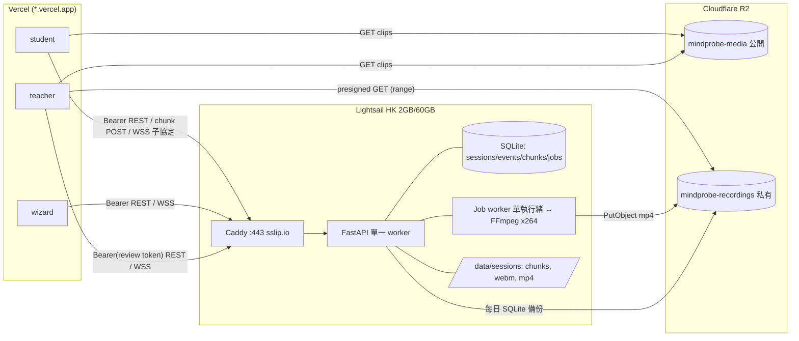

# MindProbe 部署設計 —— Phase 1：上線與 R2 影片儲存（v0.5.2）

> 版本：v0.5.2（2026-10-15）。**設計審閱已通過，可以開始 Phase 1 實作；這不代表部署驗收**（部署驗收要另外依 §18 完成端到端演練和量測後才算）。v0.5.2 確定了 D8–D11（recorder_lost 優先、finalize 30 秒、meta 保留 7 天、重新開始的流程）。v0.5.1：v0.5.1 修正了上傳序號、student 讀取狀態、重新整理後的規則、finalize 持久化（§6.7、§7.2、§7.5、權限表和測試）。以下是 v0.5 的說明：v0.4 審閱的 8 項 P1 意見（§6.4、§6.7、§7.2、§7.3、§8.2、權限表和測試清單）已修正，待複審後才能標記為正式通過。
> 本文件根據唯讀檢視的程式碼撰寫：`server/app/{main,auth,websocket,recording,models,cases}.py`、`apps/*/src`、`cases/CASE001`、`docs/`。行號是約略值。
> **範圍：Phase 1（部署和安全）**。Admin 管理頁面放在 Phase 2，見 §17。
> **過渡 OP 頁**（2026-10-29）：完整 Admin 認證仍在 §17。在那之前，`apps/op` 用 operator token 呼叫 `GET /sessions`。分頁合約見 §5，部署檢查見 §12。這不改變 Phase 1 的範圍結論，也不是部署驗收。

## 0. 已定案決定

| # | 決定 |
|---|---|
| D1 | 暫時沒有自有網域：前端放在 `*.vercel.app`，API 放在 Lightsail，主機名用 `A-B-C-D.sslip.io`，由 Caddy 自動申請 Let's Encrypt 憑證。**正式上線前必須有自有網域**（見 §10、§15）。 |
| D2 | 認證全面改用 `Authorization: Bearer`；WebSocket 用 `Sec-WebSocket-Protocol` 傳 token；正式環境不依賴跨站 cookie。 |
| D3 | 原始 WebM **不上傳到 R2**；錄影**完整**而且 mp4 驗證通過之後，才刪除本機的 chunks 和 `student_raw.webm`。（這會改變現有的保留設計，見 §13。） |
| D4 | 新增刪除學生錄影的功能，只限 teacher（§6.4）。 |
| D5 | 保留 FFmpeg 重新編碼（libx264 + aac），因為 teacher 會用 Chrome 和 Safari。用 US$12 / 2 GB 方案，一次只跑一個轉檔工作，第一次試用時量測資源用量。 |
| D6 | mp4 上傳到 R2 之後，本機仍保留副本，並監控磁碟用量。 |
| D7 | 單一機器（WS 狀態在記憶體，資料庫是 SQLite）；資料庫只存 object key；儲存層做成抽象介面（R2 和 S3 只靠設定切換）。 |
| D8 | **`recorder_lost` 優先**：`recorder_lost` 和任何由 OP 標記的 incomplete，優先於「全部 chunk 已收到就設為 complete」的規則。排程檢查和 chunk 到達時的重新檢查都**不能**把這類錄影改回 `complete`，所以不會自動轉檔或清理（§7.2、§7.3、§7.5）。 |
| D9 | **finalize 的 30 秒門檻**：錄影停止，而且 finalize 已經存進 IndexedDB 時開始計時。佇列清空就立刻送出；否則最遲 30 秒送出。chunk 重試**不會重設計時**。這只是「送出 finalize」的門檻，不是上傳逾時，也不是放棄遲到 chunk 的期限（§6.7、§7.2）。 |
| D10 | **瀏覽器 meta 保留 7 天**：已 ACK 的影片 blob 照原本規則刪除；`recording_meta` 從伺服器確認 `complete` 起保留 7 天。**未確認或 incomplete 的資料不會因為這個期限被自動清除**。瀏覽器紀錄只用於恢復，**伺服器才是準確的資料來源**（§6.7）。 |
| D11 | **重新開始的流程（Phase 1）**：wizard **不能**建立 session，只有 OP 可以。收到中斷通知時，wizard 可以暫停；由 OP 建立新的 session 和新的 join code；舊 session 保留為 incomplete。直接重新開始的捷徑留到 Phase 2（§17）。 |

## 1. 目標 / 非目標
**目標**：前端放 Vercel Pro；FastAPI、WS 和 FFmpeg 放 Lightsail 香港（Docker Compose + Caddy）；錄影和案件影片放 R2，瀏覽器直接從 R2 下載；**每個端點都有明確的權限**；錄影完整性可以驗證；session 結束後 teacher 仍能審閱。
**非目標**：水平擴充、瀏覽器直接上傳到 R2、Postgres 或 Redis、Admin 頁面（Phase 2）。

## 2. 架構



## 3. 程式碼現況重點（v0.4 重新檢視）

| 項目 | 現況 | 問題 |
|---|---|---|
| Token 格式 | `websocket.create_session_token()`：`base64url(payload).base64url(HMAC-SHA256)`，claims 包含 `sub`、`session_id`、`role`、`iat`、`exp`；TTL 是 `WS_TOKEN_TTL_SECONDS=7200`（websocket.py:132） | 字元都在 base64url 和 `.` 範圍內，可以直接放進 WS 子協定 |
| REST 認證 | `auth.extract_token`（auth.py:168）先讀 cookie，再讀 Bearer；`get_current_actor`（:185）檢查 session 綁定；**session 已 ended 時不檢查 revoke**（:211-214） | 刪除錄影這類寫入操作不能沿用這個豁免 |
| review 角色 | `REVIEW_ROLES={"teacher","observer"}`（auth.py:63）；`require_review_actor`（:226） | observer 也能通過，不適合用在刪除 |
| WS 認證 | **實際的驗證在 `websocket._verify_session_token`（websocket.py:503）**，只讀 cookie（`_cookie_value`）；`session_ws`（:1523-1545）呼叫它；`main.WebSocketSessionGuard`（main.py:~121-170）**也只讀 cookie**，並拒絕已 ended 的 session 和已 revoke 的 token；`manager.connect` 在 :338 執行 `ws.accept()`，沒有協商子協定 | 這兩個地方都要改（§6.6） |
| join | `POST /sessions/{id}/join`（main.py:327）用 join code 換 token，**只回傳 cookie，不放在 body**；**session ended 時回 409**（:344） | session 結束後 teacher 無法取得 review token（§6.5） |
| `/sessions/{id}/end` | 結束 session，並 `revoke_session_tokens` | 目前**沒有認證**，任何人都能結束 session |
| 沒有認證的端點 | `POST /sessions`（**回應包含所有 join code**）、`GET /sessions/{id}`、`GET /sessions/{id}/events`、`POST /sessions/{id}/end`、`POST /recording/{id}/chunk`、`GET /recording/{id}/status`、`POST /recording/{id}/process`、`/cases*` | 公開上線前必須補上（§5） |
| chunk 上傳 | `recording.py:668`，form 欄位有 `sequence`、`start_ms`、`end_ms`、`checksum` 和 `chunk`；**沒有「最後一段」的概念**；student 端 `useMediaRecorder.ts` 的 `sequenceRef` 從 0 開始遞增 | 無法判斷錄影是否完整（§7） |
| 轉檔 | `process_recording`（:598）和 `/recording/{id}/process`（:795）同步執行；`GET /sessions/{id}/recording`（main.py:524）在請求中**同步自動轉檔** | 改成用工作佇列（§8） |
| 轉檔參數 | `remux_to_mp4`（:447）實際是 libx264 + aac 重新編碼 | 保留，只調整參數（§8.3） |
| CORS | `allow_origins=["*"]` 加上 `allow_credentials=True`（main.py:183-190） | 改成白名單 |
| 前端網址 | `VITE_API_BASE_URL` 和 `VITE_MEDIA_BASE_URL`（`apps/*/src/config.ts`）；teacher 預設 `http://localhost:8000` | 在 Vercel 設定 env，並移除 teacher 的預設值 |
| teacher 播放 | `fetchRecordingBlob`（teacher api.ts:93）下載整個檔案；`DualVideoPlayer.tsx:176` 用 `crossOrigin="use-credentials"` | 改用 presigned URL，加上 `crossOrigin="anonymous"` |

## 4. 角色與 token 類型

| Token 類型 | 取得方式 | claims | TTL | 可撤銷 | 用途 |
|---|---|---|---|---|---|
| `live`（現有） | `POST /sessions/{id}/join` 加 join code | `typ=live`、`session_id`、`role`、`sub`、`jti` | 2 小時（現有設定） | `end` 時全部撤銷 | 即時 session 中的 REST 和 WS |
| `review`（新增，§6.5） | `POST /sessions/{id}/review-login` 加 teacher review code | `typ=review`、`session_id`、`role=teacher\|observer`、`sub`、`jti` | access 30 分鐘；refresh 7 天 | 可以逐一撤銷，也可以整個 session 撤銷 | session 結束後審閱、刪除錄影 |
| `operator`（新增，暫時方案） | 伺服器 env `MINDPROBE_OPERATOR_TOKEN`（長隨機字串） | 不是 JWT，用常數時間比對 | 手動輪替 | 改 env 就失效 | 建立 session、列出場次（`GET /sessions`，不含明文碼）、讀取建立當下回傳的 join code、手動觸發轉檔；Phase 2 改成 admin 登入 |
| R2 presigned URL | `GET /sessions/{id}/recording` | — | 15 分鐘 | 不能撤銷（到期才失效） | **只用來下載影片，不是認證憑證** |

所有 token 都會雜湊後寫入資料庫（沿用 `models.hash_token`），只有 hash 會進入 audit。

## 5. 端點 × 角色權限表（P1-1）

說明：S=student、W=wizard、T=teacher、O=observer、OP=operator、—=不允許。「綁定」指 token 的 `session_id` 必須和路徑相同。「撤銷」：✔ 表示一律檢查；`ended豁免` 表示**只有 live token 且撤銷原因（`revoke_reason`）是 `session_ended`** 時，唯讀端點才放寬。**review token 在所有 REST 和 WS 入口一律驗證 grant 與撤銷狀態，不適用任何 ended 豁免**（logout、refresh 重用偵測或 OP 撤銷之後，舊憑證立刻不能讀資料）。因安全因素撤銷的 live token（`revoke_reason≠session_ended`）也不適用豁免。

| 端點 | 目前 | Phase 1 允許 | token 類型 | 綁定 | 撤銷檢查 | 備註 |
|---|---|---|---|---|---|---|
| `GET /health` | 公開 | 公開 | — | — | — | 只回傳 ok、版本和磁碟狀態等級，不回傳路徑 |
| `GET /cases` | 公開 | OP，或任何有效 live/review token | 任一 | — | ✔ | 避免公開列出案件 |
| `GET /cases/{case_id}` | 公開 | W、T、O、OP；**S 不行**（內容包含 ground truth 和決策樹） | live/review/OP | 必須是自己 session 的 `case_id` | ✔ | **重要**：student 不應能讀到 `ground_truth` 和 `wizard_decision_tree` |
| `GET /cases/{case_id}/clips` | 公開 | S、W、T、O、OP（student 只拿到 clip_id、檔名和時長，**不含 text 和 reveals**） | 同上 | 同上 | ✔ | 需要確認 student app 實際用了哪些欄位 |
| `GET /cases/{case_id}/rubric` | 公開 | T、O、OP | live/review/OP | 同上 | ✔ | |
| `POST /sessions` | 公開，**回傳全部 join code** | OP | OP | — | — | Phase 2 改成 admin |
| `GET /sessions` | — | **只限 OP** | OP | — | — | 過渡 OP 頁（`apps/op`）。分頁合約見下。不回傳任何碼 |
| `GET /sessions/{id}` | 公開 | S、W、T、O、OP | live/review/OP | ✔ | ✔ | |
| `GET /sessions/{id}/events` | 公開 | W、T、O、OP | live/review/OP | ✔ | live：ended豁免；review：一律檢查 | student 不應看到 wizard 的事件 |
| `POST /sessions/{id}/end` | 公開 | W、T、OP | live/OP | ✔ | ✔ | 結束後會觸發 `finalizing`（§7） |
| `POST /sessions/{id}/join` | join code | 持有 join code 的人 | — | ✔ | — | session ended 時仍回 409；回應 body 改為帶 token |
| `POST /sessions/{id}/review-login`（新增） | — | 持有 review code 的人 | — | ✔ | — | §6.5 |
| `POST /sessions/{id}/review-refresh`（新增） | — | review refresh token | review | ✔ | ✔ | refresh token 每次使用就輪替 |
| `POST /sessions/{id}/review-logout`（新增） | — | review | review | ✔ | ✔ | 撤銷這組 token |
| `GET /sessions/{id}/recording/status` | T、O（`require_review_actor`） | T、O、OP | live/review/OP | ✔ | ended豁免 | 回報完整性狀態 |
| `GET /sessions/{id}/recording` | T、O | T、O | live/review | ✔ | ended豁免 | 回傳 presigned URL；寫入 audit `recording_viewed`；**不再同步轉檔** |
| `DELETE /sessions/{id}/recording`（新增） | — | **只限 T** | **只限 review**（或 OP） | ✔ | **一律檢查，沒有豁免** | `require_recording_delete_actor`（§6.4） |
| `GET /sessions/{id}/timeline` | T、O | T、O | live/review | ✔ | ended豁免 | |
| `GET /sessions/{id}/audit` | T、O | T、OP（**O 不行**） | review/OP | ✔ | ✔ | audit 內容比較敏感 |
| `POST /recording/{id}/chunk` | 公開 | **只限 S** | live | ✔ | ✔，但在 §7.3 的寬限期內允許 | |
| `POST /recording/{id}/finalize`（新增） | — | **只限 S** | live | ✔ | 同上 | 提交最後一段的 sequence（§7） |
| `GET /recording/{id}/status` | 公開 | **S（只看自己的上傳進度）**；T、O、OP 改用 `/sessions/{id}/recording/status` | live（S） | ✔ | ✔，但在 §7.3 的寬限期內允許 | **只回傳精簡欄位**：`received_sequences`（或用壓縮的區間表示）、`next_expected_sequence`（最小缺漏序號）、`final_sequence`、`finalize_state`（`none\|pending\|complete\|incomplete`）、`recording_state`。**不回傳**路徑、檔案大小、checksum、轉檔和上傳細節 |
| `POST /recording/{id}/process` | 公開，同步執行 | OP，或 T（review） | OP/review | ✔ | ✔ | 改成**只建立工作**（§8），回 202；`allow_missing_header` 只限 OP |
| `WS /ws/{id}/{role}` | cookie | path 上的 role 必須等於 token 的 role；S 和 W 各只能有一個連線，T 和 O 可以多個 | live（T 和 O 也可以用 review） | ✔ | ✔，ended 時拒絕 | §6.6 |
| `GET /cases/*` StaticFiles | 公開 | 只在 local backend 時掛載 | | | | 正式環境由 R2 提供 |

### `GET /sessions` 分頁合約（過渡 OP 頁，已依程式與測試實作）

只接受 operator token（`require_operator`）。沒有 token、錯誤 token、live 或 review token 都是 401，帶 `before` 時也一樣。

查詢參數：

- `limit`：整數，預設 50，範圍 1–200（`SESSION_LIST_MAX`）。0 或大於 200 回 422。每列會 stat 該場次的 chunk 目錄，所以上限定在 200。
- `before`：可省略。有值時必須是上一頁回應的 `next_cursor`，原樣回傳，呼叫端不要自己組。省略代表最新的一頁。長度上限 512，超過回 422（查詢驗證）。空字串或無法還原的值回 422，`detail` 為 `invalid_cursor`。

排序是 `created_at` 由新到舊，同一時間再以 `id` 由新到舊。`before` 解出上一頁最後一列的 `(created_at, id)`。下一頁只含嚴格排在這個鍵之後的列：`created_at` 較小，或 `created_at` 相同且 `id` 較小。因此 `created_at` 打平時不會重複也不會漏列。兩次翻頁之間新建立、比 cursor 更新的場次不會插進較舊的那一頁，要重新讀第一頁才看得到。

伺服器多取一列來判斷有沒有下一頁。超過 `limit` 時，`next_cursor` 是這一頁最後一列（回傳的 `sessions` 的最後一列，不是多探的那一列）的不透明 cursor。最後一頁，包含剛好滿頁但沒有多出來的列，`next_cursor` 為 `null`。Cursor 用寫進資料庫的 `created_at`（SQLite 上是 naive datetime）來和下一頁比對，避免時區換算讓同一列對不上。編碼是去掉 padding 的 urlsafe base64，內容為 JSON `[created_at.isoformat(), id]`。這只是伺服器的實作；呼叫端把 `next_cursor` 原樣放進下一次的 `before` 即可。

回應只有三個欄位：`sessions`、`next_cursor`、`upload_grace_seconds`。沒有 `after`、`cursor`、`has_more` 或 `total`。每一列是場次欄位，加上 `recording_state`、`finalize_state`、`incomplete_reason`、`needs_operator`、`stored_sequences`、`seconds_since_last_chunk`、`upload_grace_ends_at`、`upload_reissue_refusal`。不含 `join_codes`、`review_codes` 或補傳碼。

`apps/op` 每頁 `limit=50`。「載入更早的場次」把目前的 `next_cursor` 當成 `before`，接在已顯示的列後面，並去掉重複的 `session_id`；新列只記第一次讀取。「重新整理」從第一頁重讀，再沿著 `next_cursor` 繼續，直到涵蓋目前已顯示的列數，最多 20 頁。超過 20 頁的部分在重新整理後不會留在畫面上，要再按「載入更早的場次」。

上線這個頁面時，後端必須已經有這個端點和上述分頁。見 §12。

**測試清單（每一列都要有）**
1. 沒有 token → 401；token 格式錯誤或簽章錯誤 → 401；token 過期 → 401 `expired`。
2. token 綁定的 session 和路徑不同 → 401 或 403 `session_token_mismatch`。
3. 角色不符（例如 S 呼叫 `/events`、O 呼叫 DELETE、W 上傳 chunk）→ 403。
4. 已撤銷的 live token：session 進行中 → 401；session ended 且 `revoke_reason=session_ended` 時，只有標示 ended 豁免的唯讀端點可以通過，**DELETE、process 都要拒絕**，chunk、finalize 和 student 的 `GET /recording/{id}/status` 只適用 §7.3 的寬限規則；`revoke_reason` 是 `security`（洩漏、手動撤銷）的 token，**任何端點都拒絕，包含 chunk 和 finalize**。
5. review token（不論 session 是否 ended）：access token 過期 → 401；refresh 之後舊的 refresh token 失效（重複使用就撤銷整組 token，之後舊 access token 讀 `/events`、`/timeline`、`/recording`、WS 都要 401）；logout 之後失效；OP 撤銷之後失效。
6. operator token 錯誤 → 401；沒有設定 env 時，該端點一律 401。
7. WS：沒有子協定、子協定格式錯、role 不符、session 不存在、已 ended、已撤銷 → 都用 4401/4403 關閉；成功時回應的子協定只有 `mindprobe.v1`。
8. `POST /sessions` 未授權時**不能**洩漏 join code；`/cases/{id}` 對 S 不回傳 ground truth。
9. Cookie 關閉時（`MINDPROBE_AUTH_COOKIE=false`），單靠 cookie 應該全部失敗。
10. CORS：白名單以外的 origin 不會收到 ACAO header。
11. **student 讀取上傳狀態**：S 用自己 session 的 live token 呼叫 `GET /recording/{id}/status` → 200，只有精簡欄位（逐一檢查回應沒有多餘的 key）；S 讀別的 session → 401/403；W、T、O 呼叫這個端點 → 403（改用 `/sessions/{id}/recording/status`）；session 已 ended、撤銷原因是 `session_ended`，而且在寬限期內 → 200；寬限期過後 → 401；撤銷原因是 `security` → 401。
12. **finalize 重試**：同樣的 finalize 送兩次 → 都回 200，而且狀態相同（冪等）；finalize 之後再補傳缺漏的 chunk → 自動變成 `complete`。
13. **recorder_lost 優先（D8）**：送出 `reason=recorder_lost` 的 finalize → `incomplete`；之後把 0..final_sequence 全部補齊 → 仍然是 `incomplete`，沒有建立 transcode 工作，chunk 也沒有被清理；排程的寬限期檢查跑過之後 → 仍然是 `incomplete`；OP 標記 incomplete 的錄影同樣不會被改回 complete。
14. **finalize 計時（D9）**：佇列已清空 → 立刻送出；佇列裡有 chunk 一直失敗 → 計時 30 秒時送出，chunk 重試不會延後這個時間；finalize 送出之後，遲到的 chunk 仍然被接收，並能讓錄影變成 complete。
15. **meta 保留（D10）**：complete 而且確認之後 7 天才清除；pending、incomplete 和 lost 的 meta 過了 7 天仍然保留。
16. **建立 session 權限（D11）**：wizard 呼叫 `POST /sessions` → 401/403。
17. **OP 場次列表與分頁**：見上方 `GET /sessions` 合約。非 OP（含 live token，以及帶 `before`）→ 401；`limit` 超出 1–200 → 422；畸形 `before` → 422 `invalid_cursor`；各頁走完每場恰好一次，最後一頁 `next_cursor` 為 null；回應沒有任何碼。

## 6. 認證和程式碼改動

### 6.1 新增 `server/app/storage.py`
`Storage` protocol 包含 `put_file`、`exists`、`presign_get`、`public_url`、`delete`；實作有 `LocalStorage` 和 `S3Storage`（boto3，可以設定 endpoint，同時支援 R2 和 S3）；由 `MINDPROBE_STORAGE_BACKEND=local|s3` 選擇。
### 6.2 共用驗證函式（`auth.py`）
- 把 `websocket._verify_session_token` 的簽章、過期、session 和 role 檢查**抽出成 `auth.verify_token(token, *, session_id, roles=None, typ=None) -> Claims`**。REST 和 WS 共用這個函式，避免兩套邏輯不一致。
- `extract_token(request)`：**先讀 Bearer**；只有 `MINDPROBE_AUTH_COOKIE=true` 時才讀 cookie（給開發和同網域環境使用）。
- 新增 `require_roles(*roles, typ=..., revocation="strict"|"ended_exempt")` 依賴工廠，§5 的每一列都用它宣告權限。
- `require_operator`：用 `hmac.compare_digest` 比對 `MINDPROBE_OPERATOR_TOKEN`。
### 6.3 CORS（main.py:183）
`allow_origins` 讀 `MINDPROBE_CORS_ORIGINS`；`allow_credentials=False`；`allow_headers=["Authorization","Content-Type"]`。Preview 的處理方式未定（§16）。
### 6.4 刪除錄影：`require_recording_delete_actor`（P1-2）
**不沿用** `require_review_actor`（它允許 observer，而且 session ended 時不檢查撤銷）。新的依賴：
```python
def require_recording_delete_actor(request, session_id, db) -> Actor:
    token = extract_token(request)                     # Bearer only
    claims = verify_token(token, session_id=session_id, typ="review")  # 簽章/exp/session 綁定
    if claims["role"] != "teacher": raise 403
    if models.is_token_hash_revoked(db, session_id, hash_token(token)): raise 401   # 無 ended 豁免
    if models.is_review_grant_revoked(db, claims["jti"]): raise 401
    return Actor(...)
```
（另外允許 `require_operator`，作為人工處理的管道。）
`DELETE /sessions/{id}/recording` 的流程（**SQLite 沒有列鎖，交易絕不跨越 R2 或檔案操作**）：
1. body 帶 `{"confirm": session_id}`。
2. **短交易**（只做資料庫寫入，毫秒級）：`recording_state=deleting`、記錄 `deleted_by`、把這個 session 未完成的 transcode/upload 工作設為 `cancelled`、寫入 audit `recording_delete_requested`、建立 `delete_recording` 清理工作（§8.4），然後立刻 commit。
3. 回 202（已經是 `deleting` 或 `deleted` 則冪等回 202 或 204）。
4. 清理由 `delete_recording` 工作執行：刪除 R2 物件（冪等）→ 刪除本機 mp4、webm 和 chunks → **另一個短交易**設定 `recording_state=deleted`、`recording_key=NULL`、`deleted_at` 並寫入 audit `recording_deleted`。失敗時依 §8.2 重試，狀態保持 `deleting`。
狀態 `deleting` 期間，GET 回 410，上傳和轉檔都拒絕；UI 輪詢狀態直到 `deleted`。
已經發出的 presigned URL 最多還能播放 15 分鐘；Lightsail 快照裡的本機副本會留到快照輪替為止，要寫進私隱聲明。
UI：`DualVideoPlayer` 加一個「刪除錄影」按鈕，要求輸入 session ID 確認，並呼叫新的 `deleteRecording()`。

### 6.5 session 結束後的 review 認證（P1-4）
問題：`/join` 在 session ended 後回 409，live token 2 小時就過期，而且 `end` 會撤銷所有 live token。
設計：
- **review code**：`POST /sessions` 時，除了現有的 join code，額外產生 teacher 和 observer 各一組 review code（存 hash；明文只在建立時回傳給 OP 一次；可以重新產生，重新產生後舊的失效）。
- `POST /sessions/{id}/review-login {review_code, client_id}` → 回傳 `{access_token(30 分鐘), refresh_token(7 天), role, expires_at}`。session 狀態不限，進行中或已結束都可以。review code **可以重複使用**（跟一次性的 join code 不同），但要有速率限制（每個 IP 每分鐘 5 次）並寫入 audit。
- 新增 `review_grants` 資料表：`jti`、`session_id`、`role`、`client_id`、`refresh_hash`、`issued_at`、`expires_at`、`revoked_at`、`rotated_from`。
- refresh 時輪替：舊的 refresh token 失效；**如果舊的 refresh token 被重複使用，就撤銷整條 token 鏈**。
- 撤銷：`review-logout` 撤銷自己的 grant；OP 可以撤銷整個 session 的所有 grant（`POST /sessions/{id}/review-revoke`，只限 OP）。錄影刪除後 grant 仍然有效，可以繼續看 timeline。
- teacher UI：`SessionJoinBar` 新增「審閱登入（review code）」模式；token 存在記憶體和 sessionStorage；收到 401 `expired` 時自動 refresh。
- presigned URL 是另一回事：它只是 15 分鐘有效的下載連結，由持有有效 review 或 live token 的人經 `GET /recording` 取得，**不能用來呼叫 API**。

### 6.6 WebSocket 認證（P1-5）
**`server/app/websocket.py`**
- `_verify_session_token(websocket, session_id, role)`（:503）：改成從 `websocket.scope["subprotocols"]` 讀取 token，格式是 `["mindprobe.v1", "bearer.<token>"]`。只有 `MINDPROBE_AUTH_COOKIE=true` 時，才退回讀 cookie（`_cookie_value`）。
- 取出 token 之後呼叫 `auth.verify_token(token, session_id=session_id, roles={role})`，檢查簽章、`exp`、`session_id` 和 `role`（path 上的 role 必須等於 token 的 role）。`typ` 允許 `live`；T 和 O 另外允許 `review`。
- 撤銷檢查：查 `models.is_token_hash_revoked`；review token 另外查 `review_grants`。**目前這段檢查只在 `main.WebSocketSessionGuard` 裡**，要搬到這裡，或者兩處都檢查。
- 子協定協商：`session_ws`（:1523）驗證通過後，把要回應的子協定傳給 `manager.connect(...)`；`connect` 裡的 `await ws.accept()`（:338）改成 `await ws.accept(subprotocol="mindprobe.v1")`。**絕對不能把 `bearer.*` 回傳給客戶端。**沒有提供 `mindprobe.v1` 的連線，在驗證失敗後用 4401 關閉。
- 驗證失敗時沿用 4401（認證失敗）和 4400（role 不合法）；角色不符用 4403。
- 長時間的連線：token 在連線期間過期不會強制斷線（現有行為）；但如果 session 被 end，或 token 被撤銷，應該主動關閉連線（end_session 時呼叫 manager 關閉該 session 的所有 WS）。
**`server/app/main.py` `WebSocketSessionGuard`（:~121-170）**：`_scope_cookie_value` 改成同樣從 subprotocols 取 token（共用一個 helper），否則這個 guard 會在進入 `session_ws` 之前就拒絕連線。或者把它的檢查全部移到 `session_ws`，只保留一處，**建議用這個做法**。
**前端**：student、wizard 和 teacher 建立 WS 的地方（檔名待確認）改成 `new WebSocket(sessionSocketUrl(id), ["mindprobe.v1", "bearer." + token])`。
**Caddy 和 uvicorn**：不記錄 `Sec-WebSocket-Protocol` 和 `Authorization` header。

### 6.7 前端（簡要）
- 移除所有 `credentials: "include"`，改帶 `Authorization: Bearer`；`/join` 和 `/review-login` 回傳的 token 存在記憶體和 sessionStorage。
- teacher 播放器改用 presigned URL 加上 `crossOrigin="anonymous"`；URL 過期時（`onError`）重新取得，並回到原本的 `currentTime`。
- student 錄影改用**持久化上傳佇列**（IndexedDB，現有 `useMediaRecorder.ts` 只在記憶體保留最近 60 段，失敗的舊 chunk 無法重試，重新整理也會遺失）：
  - IndexedDB 有兩個 object store：
    - `chunks`：`{session_id, sequence, start_ms, end_ms, checksum, blob}`，伺服器回 accepted 或 duplicate ACK 之後才刪除這一筆；其他情況用指數退避重試。
    - `recording_meta`（每個 session 一筆）：`{session_id, next_sequence, recorder_started_at, recorder_state: recording|stopped|lost, final_sequence?, finalize_pending: bool, finalize_payload?, finalize_confirmed: bool}`。
  - **配發序號（P1-1）**：每產生一個 chunk，就在**同一個 readwrite transaction**（`chunks` 和 `recording_meta`）中讀取 `next_sequence` 作為這段的序號，寫入 chunk，並把 `next_sequence` 加 1。transaction 完成之後才送出上傳。`next_sequence` **不會因為收到 ACK 或刪除 chunk 而減少或刪除**，只有在 session 完整結束（`finalize_confirmed`）而且保留期過後，才連同整筆 meta 一起清除。
  - **不能**用「IndexedDB 裡剩下的 chunk 的 `max(sequence)+1`」推算下一個序號：已經 ACK 的 chunk 會被刪除，佇列清空之後就會從 0 重新編號，造成序號衝突，伺服器會回 409。
  - **重新整理和重連**：讀取 `recording_meta`，再呼叫 `GET /recording/{id}/status`（S 可以讀，見 §5），用 `received_sequences` 刪除本機已經送達、但 ACK 遺失的項目，只補送其餘的項目。規則見 §7.5（**不重新開始錄影**）。
  - 佇列有容量上限（例如 500 MB），接近上限時在 UI 警告；結束前顯示「尚有 N 段未上傳」。
  - **finalize（P2-4，和 §7.2 統一規則）**：錄影停止（`recorder.onstop`，最後一段已寫入 IndexedDB）時，**立刻**把 `finalize_payload = {final_sequence: next_sequence-1, total_chunks: next_sequence, total_duration_ms}` 寫入 `recording_meta`，並設定 `finalize_pending=true`。同時記錄 `finalize_persisted_at`（**開始計時**）。之後依 §7.2 的單一規則送出，並持續重試（指數退避；重新整理後也從 IndexedDB 繼續，計時起點不變）。
  - **meta 保留（D10）**：已 ACK 的 chunk blob 照原本規則刪除。`recording_meta` 從 `finalize_confirmed`（伺服器確認 `complete`）起保留 7 天，之後才清除。`finalize_state` 是 `pending` 或 `incomplete`，或是 `recorder_state=lost` 的 meta 和 chunk，**不會因為 7 天期限被自動清除**，只能在伺服器確認之後，或由使用者或 OP 明確處理後才清除。瀏覽器紀錄只用於恢復，判斷完整性一律以伺服器的 `/recording/{id}/status` 為準。
  - **「可以安全關閉」**：只有在伺服器的 finalize 回應或 status 顯示 `finalize_state=complete`（全部序號都已收到並通過驗證）時，才設定 `finalize_confirmed=true` 並顯示。佇列清空但還沒確認時，顯示「正在確認…請勿關閉」；如果是 `incomplete`，顯示「錄影不完整，已通知管理員」。
- 移除 teacher `config.ts` 的 localhost 預設值；每個 app 新增 `vercel.json`（SPA rewrite、CSP、Permissions-Policy）。

## 7. 錄影完整性（P1-3）

### 7.1 狀態機（`sessions.recording_state`，或新增 `recordings` 資料表）
```
recording ──(student finalize 或 session end)──▶ finalizing
finalizing ──(0..final_seq 全到 + header OK)──▶ complete ──▶ transcoding ──▶ transcoded ──▶ uploaded
finalizing ──(寬限期到仍缺 chunk / 無 finalize)──▶ incomplete
incomplete ──(OP 手動以 allow_missing_header/allow_gaps 轉檔)──▶ transcoding（標記 partial=true）
transcoding ──(失敗)──▶ transcode_failed（可重試）
任何狀態 ──(teacher DELETE)──▶ deleting ──▶ deleted
```

### 7.2 最後一段 sequence
- 新增 `POST /recording/{id}/finalize {final_sequence, total_chunks, total_duration_ms}`，只限 S 的 live token（§7.3 寬限期內也可以）。
- **送出時機（唯一規則，v0.5.1 統一）**：finalize 的內容在 `onstop` 時就已經固定並存進 IndexedDB（§6.7）。**計時從 `finalize_persisted_at` 開始（錄影停止，而且 finalize 已經存進 IndexedDB）。佇列清空就立刻送出；否則在計時滿 30 秒時送出**（帶同樣的 `final_sequence`）。chunk 重試和退避**不會重設計時**。30 秒**只是送出 finalize 的門檻**，不是 chunk 的上傳逾時，也不是放棄遲到 chunk 的期限；送出之後，未完成的 chunk 照常重試（D9）。也就是說，finalize **不必等所有 chunk 都送達**。伺服器會根據 `final_sequence` 判斷缺漏，缺漏的 chunk 後續補傳成功時，再自動轉為 `complete`。student 在收到確認之前會一直重送 finalize。
- **冪等**：同樣的內容可以重送，伺服器一律回 200，並帶目前的 `finalize_state` 和 `missing_sequences`（只列序號）。前端用這個回應決定是否顯示「可以安全關閉」。
- 伺服器記錄 `final_sequence`，然後做**完整性檢查**。現有 `missing_sequences()`（recording.py:266）只比較「已收到的最小到最大序號」，收到 [0,1]、宣告 `final_sequence=2` 時仍回傳 []，**不能直接使用**。新增 `missing_for_final(received, final_sequence)`：以 `set(range(0, final_sequence+1)) - set(received)` 計算缺漏，同時要求 `total_chunks == final_sequence+1` 且 `len(set(received)) == total_chunks`，並驗證 header chunk 有效（`validate_header_chunk`，:280）。三項全部通過才設為 `complete` 並**建立轉檔工作**；否則保持 `finalizing`，等待補傳；**每次收到 chunk 都重新檢查**，一旦補齊就自動變成 `complete`。**優先規則（D8）**：如果錄影已經標記為 `incomplete_reason=recorder_lost`，或有 OP 標記的 `needs_operator`、`operator_incomplete`，重新檢查時**不能**改回 `complete`，只會更新 `missing_sequences`；這類錄影只能由 OP 明確觸發 partial 轉檔。測試要涵蓋：缺尾段、缺頭段、中間缺漏、`total_chunks` 不符、重複序號。
- 如果收到 `sequence > final_sequence` 的 chunk，回 409。重複呼叫 finalize 並帶不同的值時，回 409，除非仍在 `finalizing` 而且新值比較大（例如 onstop 時又產生了最後一段）。

### 7.3 session 結束後的補傳寬限期
- `POST /sessions/{id}/end` 會撤銷 live token，但**寬限期內允許 student 的 live token 繼續上傳 chunk 和呼叫 finalize**。
- token 撤銷紀錄新增 `revoke_reason`：`session_ended`（`/end` 造成）或 `security`（洩漏、手動、重複使用偵測）。
- 規則：`session.ended_at + MINDPROBE_UPLOAD_GRACE_SECONDS`（預設 600 秒）以內，而且 token 的 `role=student`、`session_id` 相符、`exp` 未過期（簽章有效）、**撤銷原因只能是 `session_ended`**。`security` 撤銷的 token 在任何時間都不能上傳。**只開放 `/recording/{id}/chunk`、`/finalize` 和 `GET /recording/{id}/status`（student 的精簡版）這三個端點**，WS 和其他端點不受影響。
- 實作：在 `require_roles(..., revocation="grace_upload")` 裡判斷 `revoke_reason=="session_ended" and session.status=="ended" and now < ended_at+grace`。若日後想完全避免依賴舊 token，可改為 `/end` 時另發限上傳用途的短期 upload token（`typ=upload`，只能呼叫這三個端點）。
- 寬限期結束時，由排程工作（§8 worker 每分鐘檢查一次）處理（**先套用 D8**：已經標記 `recorder_lost` 或 OP incomplete 的錄影一律跳過，維持 incomplete）：已經有 finalize 而且沒有缺漏就設為 `complete`；否則設為 `incomplete`，並寫入 audit 和 log 告警。
- 如果 student token 本身在寬限期內過期（2 小時 TTL），就不能再補傳；可以考慮把 `exp` 延長到 session 時長再加寬限期。

### 7.4 清理規則
- **只有在狀態是 `complete`（或 OP 手動確認的 `partial`），而且 mp4 已通過 `probe_media` 驗證之後，才刪除 chunks 和 `student_raw.webm`。**
- 狀態是 `incomplete` 或 `transcode_failed` 時，**永遠不刪除** chunks 和 raw webm。
- 刪除前把 chunk 清單、sha256、`final_sequence` 和缺漏清單寫入 `recordings.manifest`（JSON），供日後稽核。
- 本機 mp4 保留（D6）。

### 7.5 重新整理和錄影中斷（P1-3）
**Phase 1 規則：一個 session 只有一段 MediaRecorder 錄影。**
- 頁面重新整理、瀏覽器當掉或分頁被關閉之後，student app **只補傳原本錄影中還在 IndexedDB 的 pending chunk**，以及 pending 的 finalize，**不會再呼叫 `MediaRecorder.start()` 開始新的錄影**。
- 理由：W3C MediaStream Recording 規範只保證**同一次錄影**（同一個 MediaRecorder 從 start 到 stop）產生的 blob 依序串接後可以播放；新的 recorder 會產生新的檔頭和時間軸，接在後面的話，合併出來的 webm 可能無法播放，或者時間錯亂。
- 如果原本的錄影已經遺失（`recording_meta.recorder_state` 是 `recording`，但頁面已經重新載入，recorder 不存在）：
  1. 前端把 `recorder_state` 設為 `lost`，並把**目前已經擁有的最後一段序號**（`next_sequence-1`）當作 `final_sequence`，送出 finalize，加上 `reason: "recorder_lost"`。
  2. 伺服器**一收到** `reason: "recorder_lost"` 就把狀態設為 **`incomplete`**（`incomplete_reason=recorder_lost`），加上 `needs_operator=true`，寫入 audit 並發出告警。之後補傳的 chunk 照常接收，但**即使全部到齊也不會改成 complete**（D8）。這種情況**不會自動轉檔，也不會清理 chunk**（§7.4）。OP 可以用 partial 模式處理已有的部分。
  3. UI 顯示「錄影已中斷，請通知老師或管理員」；Wizard 和 teacher 透過 WS 收到 `recording_failure` 事件（現有的暫停原因）。**Phase 1（D11）**：wizard 可以暫停，但不能建立 session；需要重來時，由 OP 建立新的 session 和新的 join code，舊 session 保留為 incomplete。
- 已經 finalize 並確認的 session，重新整理後只會顯示「已完成，可以安全關閉」。

**Phase 2 選項：`recording_segment_id`（不在 Phase 1 範圍）**
- 每次 `MediaRecorder.start()` 都產生新的 `recording_segment_id`。chunk 改用 `(segment_id, sequence)` 作為 key，每個 segment 各自有 header 和 finalize。
- 伺服器**分別合併每個 segment**（各自成為完整的 webm 並轉成 mp4），再用每個 segment 的 `recorder_started_at`（換算成伺服器時鐘，ADR-0003）把它們對齊到 session 時間軸上；teacher 播放器支援多段影片和中間的空白，或者在轉檔時插入黑畫面接成一個 mp4。
- 這樣才能在重新整理後繼續錄影，但會改動 chunk schema、狀態機和播放器，所以留到 Phase 2。

## 8. 工作佇列：SQLite job table（P2-6）

### 8.1 資料表 `jobs`
`id`、`kind`（`transcode`|`upload`|`finalize_timeout`|`sqlite_backup`|`delete_recording`|`delete_orphan_object`）、`session_id`、`status`（`queued`|`running`|`succeeded`|`failed`|`cancelled`）、`attempts`、`max_attempts`（預設 3）、`run_after`、`locked_by`、`locked_at`、`heartbeat_at`、`last_error`、`created_at`、`updated_at`。另外對 `(kind, session_id)` 加上 **UNIQUE 限制（只套用在 queued 和 running 狀態，用 partial index）**，讓建立工作的操作是冪等的。

### 8.2 Worker
- FastAPI `lifespan` 啟動**一個**背景執行緒（uvicorn 一定要 `--workers 1`）。每個程序啟動時產生 `worker_instance_id`（UUID），寫入 `jobs.locked_by`。worker 用子查詢選出 ID，再以條件式 UPDATE 原子認領（SQLite 的 `UPDATE ... ORDER BY ... LIMIT` 需要編譯選項，實測 3.49.1 語法錯誤，**不可使用**）：
  ```sql
  UPDATE jobs SET status='running', locked_by=:wid, locked_at=:now, heartbeat_at=:now, attempts=attempts+1
  WHERE id = (SELECT id FROM jobs WHERE status='queued' AND run_after<=:now ORDER BY id LIMIT 1)
    AND status='queued'
  RETURNING *;
  ```
  沒有回傳列就表示沒有工作或被搶先認領。同一時間只會跑一個工作，FFmpeg 也就一次只有一個。
- **恢復（啟動時和持續進行）**：(a) 啟動時，把所有 `status='running' AND locked_by != 自己的 worker_instance_id` 的工作立刻改回 `queued`（上一個程序已經不存在，不必等五分鐘，單一 worker 的前提讓這是安全的）；(b) 執行中，worker 迴圈每分鐘回收 `running AND heartbeat_at < now-5分鐘` 的工作；執行中的工作每 30 秒更新 `heartbeat_at`。若 `attempts>=max_attempts` 則設為 `failed` 而不是 `queued`。測試：認領後立刻 kill 容器再重啟，工作要被重新執行。
- 失敗時依指數退避重試（1、5、15 分鐘）；超過 `max_attempts` 就設為 `failed`，記錄 `recording_state`，並寫入 log 告警。
- **冪等**：
  - transcode：如果已經有通過驗證的 mp4，就直接成功。
  - upload：先 `HEAD`，如果物件存在而且 sha256 相符，就直接成功。
  - 所有輸出都先寫到暫存檔，再用原子 rename 換上。
- **每個步驟開始前都重新讀取 `recording_state`**：如果是 `deleting` 或 `deleted`，就把工作設為 `cancelled`，不上傳。上傳完成之後再用短交易確認一次狀態；如果發現在上傳期間被刪除了，**就建立持久化的 `delete_orphan_object` 工作（payload 為 object key）**，再執行刪除，而不是只在記憶體中補刪。刪除 API 也會把未完成的工作設為 `cancelled`（§6.4）。
- **崩潰後的保證**（見 §8.4）：即使 R2 已上傳成功、程序在補刪前崩潰，job 已 cancelled，重啟時的對帳也會對所有 `deleting`／`deleted` 的 session 再次對其 object key 做冪等刪除，不會留下已宣稱刪除的影片。
- `POST /recording/{id}/process` 和 `GET /recording` 都**不在請求中執行 FFmpeg**，只建立工作，並回 202 或 409 `processing`。

### 8.4 刪除清理工作和對帳
- `kind` 新增 `delete_recording` 和 `delete_orphan_object`；這兩種工作**不受 `cancelled` 取消規則影響**，建立時就持久化，`max_attempts` 不設上限（或很高）並以指數退避重試，失敗只告警，不放棄。
- 清理動作全部冪等：R2 `DeleteObject` 對不存在的 key 視為成功；刪檔時忽略不存在。
- **啟動對帳（lifespan）和每小時對帳**：找出所有 `recording_state IN ('deleting','deleted')` 的 session，對其 `recording_key`（或固定規則 `sessions/{id}/student.mp4`）再執行一次冪等刪除，並確認本機檔案已不存在；`deleting` 但沒有對應 `delete_recording` 工作的，補建一個。這樣可以涵蓋崩潰、工作被誤取消和重啟的情況。
- 因為 `deleted` 之後 `recording_key` 會設為 NULL，對帳使用固定 key 規則，而且 `deleted` 狀態要保留 `deleted_at`，供稽核。
- 測試：模擬 R2 已上傳完成、程序在補刪前被 kill、重啟後物件必須被刪除。

### 8.3 FFmpeg（保留重新編碼，最後才調整）
`-c:v libx264 -preset veryfast -crf 23 -pix_fmt yuv420p -profile:v high -c:a aac -b:a 96k -threads 2 -movflags +faststart`，用 `nice -n 10` 執行，並設定逾時；可以選擇 `scale` 上限 720p。每場約 7 MB（測試資料是 7.4 MB 和 5.6 MB）。**第一次試用時量測** `docker stats`、`/usr/bin/time -v`、Lightsail 的 CPU 和 burst credit，以及轉檔時 WS 的延遲；如果 credit 持續耗盡，就改成 `-threads 1`、720p，或升級到 4 GB。

## 9. R2 bucket 和 key
| Bucket | 存取 | key |
|---|---|---|
| `mindprobe-media` | 公開讀取。**試用期間用 r2.dev，只限內部驗證**；正式上線必須綁定自訂網域（§10） | `cases/{case_id}/media/{file}`（和 clip_manifest 的 `file` 欄位對應） |
| `mindprobe-recordings` | 私有，只透過 presigned URL 存取 | `sessions/{session_id}/student.mp4`；`backups/sqlite/{YYYY-MM-DD}/mindprobe.db.gz` |

R2 CORS 只允許 GET 和 HEAD，`AllowedHeaders: Range`，並 expose `Content-Range`、`Accept-Ranges`、`Content-Length`。recordings bucket 只允許 teacher 的 origin。
資料庫只存 key。案件影片用版本化檔名，搭配 `Cache-Control: immutable`。

**案件資料**：伺服器上**沒有 `case.json`**。`cases/CASE001/` 實際有 7 個 JSON 檔案，都要部署到伺服器的 `/data/cases/{id}/`，**不放到公開的 R2**（其中包含答案和決策樹）：
1. `case_metadata.json`：案件資訊
2. `clip_manifest.json`：影片片段清單（`file` 欄位對應 R2 的 key）
3. `disclosure_rules.json`：資訊揭露規則
4. `ground_truth.json`：案件真相（**敏感**）
5. `rubric.json`：評分標準
6. `suspect_knowledge.json`：嫌疑人知道的資訊（**敏感**）
7. `wizard_decision_tree.json`：Wizard 決策樹（**敏感**）

（`storyboard.md.bak` 不部署。）`media/` 有 30 段 mp4（45.9 MB），加上 3 張 anchor PNG（約 5.5 MB）。上傳到 R2 的是 mp4 和 PNG；`.gitkeep` 不上傳。

## 10. 網域、HTTPS 和流量
- **試用階段（沒有網域）**：API 用 `A-B-C-D.sslip.io` 加 Caddy 自動申請的 LE 憑證（先綁定 Static IP）；案件影片用 r2.dev；前端用 `*.vercel.app`。
- **r2.dev 只能用於內部驗證**：Cloudflare 對它有速率限制，也沒有快取和 WAF，不適合正式使用。
- **正式上線的前提：購買自有網域**（每年約 US$10），把 `media.<網域>` 綁到 R2，`api.<網域>` 指向 Lightsail（或改用 Cloudflare Tunnel）。這和 D1「暫時沒有網域」並不衝突，D1 只適用於試用階段。**網域是正式上線的阻擋項目**（§16）。
- **Lightsail 流量**：香港區的流量額度只有其他區域的一半，**US$12 方案是 1.5 TB/月**，超出的部分另外收費。影片下載走 R2，只有 chunk 上傳（每場約 50 MB 的 webm）和 API 會用到 Lightsail 的流量，1.5 TB 大約可以支撐 2 萬場以上，足夠使用。

## 11. 環境變數
| 變數 | 範例 / 說明 |
|---|---|
| `MINDPROBE_ENV` | `production` |
| `MINDPROBE_AUTH_COOKIE` | `false` |
| `MINDPROBE_WS_TOKEN_SECRET` | 固定的 64 hex 字串（**一定要設定**，否則每次重啟會隨機產生新值） |
| `MINDPROBE_OPERATOR_TOKEN` | 長隨機字串 |
| `MINDPROBE_REVIEW_ACCESS_TTL` / `MINDPROBE_REVIEW_REFRESH_TTL` | `1800` / `604800` |
| `MINDPROBE_UPLOAD_GRACE_SECONDS` | `600` |
| `MINDPROBE_CORS_ORIGINS` | student、wizard、teacher 的 `https://<app>.vercel.app`；部署 `apps/op` 時加上該頁的 origin（§6.3、§12） |
| `MINDPROBE_STORAGE_BACKEND` | `s3` |
| `MINDPROBE_S3_ENDPOINT` / `_REGION` / `_ACCESS_KEY_ID` / `_SECRET_ACCESS_KEY` | R2：`https://<acct>.r2.cloudflarestorage.com`、`auto` |
| `MINDPROBE_MEDIA_BUCKET` / `MINDPROBE_RECORDINGS_BUCKET` | |
| `MINDPROBE_PRESIGN_TTL_SECONDS` | `900` |
| `MINDPROBE_DISK_WARN_PCT` / `MINDPROBE_DISK_MIN_FREE_GB` | `70` / `5` |
| `MINDPROBE_FFMPEG_THREADS` / `MINDPROBE_FFMPEG_PRESET` | `2` / `veryfast` |
| 現有 | `MINDPROBE_DB_URL=sqlite:////data/mindprobe.db`、`MINDPROBE_CASES_DIR=/data/cases`、`MINDPROBE_SESSIONS_DIR=/data/sessions` |
| Vercel | `VITE_API_BASE_URL=https://A-B-C-D.sslip.io`、`VITE_MEDIA_BASE_URL=https://pub-<hash>.r2.dev`。每個前端專案都要設 `VITE_API_BASE_URL`。OP 頁不使用 `VITE_MEDIA_BASE_URL` |

## 12. Lightsail 部署步驟
1. 建立 Instance：Hong Kong、Ubuntu 24.04、US$12（2 GB RAM、60 GB SSD、1.5 TB 流量），建立並綁定 Static IP。
2. 防火牆只開 22（限制成你的 IP）、80、443。
3. 系統更新，啟用 unattended-upgrades、2 GB swap、fail2ban，SSH 只用金鑰登入。
4. 安裝 Docker，用 deploy key `git clone` 到 `/opt/mindprobe`；`.env` 權限設為 600。
5. 把 `cases/{id}/` 的 7 個 JSON 檔放到 `/opt/mindprobe/data/cases/{id}/`（不含 media）。
6. Compose：server 用 `restart: unless-stopped`、`expose: 8000`；uvicorn 加 `--workers 1 --proxy-headers --forwarded-allow-ips=<caddy>`；Caddy 服務的設定：
   ```
   A-B-C-D.sslip.io {
     request_body { max_size 20MB }
     log { format filter { request>headers>Authorization delete
                           request>headers>Sec-Websocket-Protocol delete } }
     reverse_proxy server:8000
   }
   ```
7. 執行 `docker compose up -d --build`，然後測試 `/health`、WSS 子協定，並跑 §5 的權限測試（對正式環境做唯讀的冒煙測試）。
8. 端到端演練（§18 第 7 步）。

### 部署過渡 OP 頁（`apps/op`）

上線 OP 前端時，後端必須已經包含 `GET /sessions` 和 §5 的分頁（`before`／`next_cursor`）。頁面登入會呼叫 `GET /sessions`。舊後端沒有這個路由時列表失敗，頁面不能用。只更新前端、不更新後端，不算完成部署。

下列項目這份設計裡已經寫過，部署 OP 頁時照做：

- **Vercel 專案**：另外一個專案，root 指到 `apps/op`，和 student、wizard、teacher 分開。
- **`VITE_API_BASE_URL`**：見 §11。production build 沒設定會失敗。OP 頁不讀 `VITE_MEDIA_BASE_URL`。Teacher 的 Vercel Preview 若沒有 `VITE_API_BASE_URL`，那是既有的 Preview 設定（teacher 的 production build 本來就要求這個變數），不是 OP 頁這次改動造成的。
- **CORS**：把 OP 頁的 origin 加進 `MINDPROBE_CORS_ORIGINS`（§6.3、§11 的白名單）。

比對用的祕密仍是伺服器 env `MINDPROBE_OPERATOR_TOKEN`。過渡頁讓 OP 把 token 貼進瀏覽器，只放在 React state，不寫 storage、cookie 或 URL。§17 的 admin 登入仍是要換掉這個做法的項目。

## 13. 保留政策，以及要更新的 ADR 和 spec
現有設計（ADR-0004 §4「資料保留優先順序」：原始事件 > 原始 WebM > 最終 MP4 > 自動產生報告；`docs/spec.md` 約 :189 也有相同描述）把**原始 WebM 的優先順序排在 MP4 之前**。D3「完整轉檔後刪除 raw WebM」會改變這個設計，所以要同步更新以下文件：
- `docs/adr/0004-cross-cutting-rules.md` §4：新增「錄影完整（§7）而且 mp4 驗證通過之後，可以刪除原始 WebM；incomplete 一律保留」，並說明 R2 上的 mp4 才是長期保存的版本。建議另外寫一份 ADR-0005〈雲端部署與錄影保留〉，說明這次的變更。
- `docs/spec.md` §10.1（約 :48、:189）：更新錄影流程和保留順序；加入 finalize、寬限期和狀態機。
- `docs/roadmap.md`（約 :46、:101、:170）：「資料保留優先順序」和「驗證失敗前不清除暫存和原始 chunk」的描述要改成新規則（目前的寫法和 D3 不衝突，但要補上完整性的條件）。
- `docs/adr/0001-websocket-architecture.md`（約 :77，student 端用 IndexedDB 保留未確認的 chunk）：補上 finalize 的流程。
- `server/app/recording.py` 的模組 docstring（:1-30）：補充清理規則。

其他保留政策的未決事項：錄影在 R2 上保留多久；本機 mp4 保留多久（60 GB 以每場 7 MB 計，大約可以放 4,300 場才到 70% 告警線）；audit 紀錄保留多久；SQLite 備份保留 30 天。

## 14. 備份與監控
- 開啟 Lightsail 每日快照（依已使用量計）。
- 每天由 `jobs` 執行 `sqlite_backup`：`.backup` 加 gzip 後上傳到 R2，用 lifecycle 保留 30 天；每季做一次還原演練。
- 磁碟：`/health` 回報磁碟狀態等級；超過 70% 告警；剩餘空間少於 5 GB 時拒絕建立新 session。
- 監控工作佇列：`failed` 或 `incomplete` 的工作和錄影要寫入 log，並發出告警（Phase 2 在 admin 頁面顯示）。

## 15. 安全重點
Bearer 認證；WS 用子協定傳 token；log 過濾敏感 header；CORS 白名單；token 綁定 session 和角色、設定短效期並可以撤銷；review token 採 refresh 輪替加上重複使用偵測；operator token 的祕密只放在伺服器 env，由伺服器比對；recordings bucket 私有、presigned URL 15 分鐘；R2 API token 只給兩個 bucket 的權限；student 拿不到 ground truth 和決策樹；`vercel.json` 設定 CSP，降低 XSS 竊取 token 的風險。過渡 OP 頁（§5、§12）在 §17 的 admin 登入之前，會讓 OP 把同一枚 token 貼進瀏覽器，而且只留在該分頁的記憶體。

## 16. 風險 / 未決問題
1. **【正式上線的阻擋項目】自有網域**：r2.dev 只能用於內部驗證，sslip.io 依賴第三方。
2. **【仍未決定】Vercel Preview**：(a) Preview 不連 API；(b) 用 `allow_origin_regex` 允許該 team 的 preview 網域；(c) 另外設一台 staging API。
3. review code 的發放方式：在 Phase 2 之前由 OP 手動轉交是否可以接受？observer 是否也需要 review code？
4. 寬限期的預設值（600 秒）和 student token 的 TTL（2 小時）是否足夠？長時間的 session 要延長。
4a. ~~finalize 30 秒門檻、meta 保留期、wizard 重新開始~~ → **已決定**，見 D9、D10、D11。
5. `/cases/{id}/clips` 給 student 時要隱藏哪些欄位，需要確認 student app 實際使用的欄位。
6. 錄影 incomplete 時，是否允許 teacher 自己觸發 partial 轉檔，還是只限 OP？
7. anchor PNG 是否也要放到公開的 R2（student app 有沒有用到）。
8. 2 GB 機器的 burst credit：要在第一次試用時量測。
9. 單一機器是單點故障。

## 17. Phase 2 大綱：Admin 管理頁面（P2-7，不在本次範圍）

過渡實作（完整 admin 認證之前）：`apps/op` 提供建場次、複製建立時回傳的碼、補傳碼、重新產生 review code，以及只限 OP 的 `GET /sessions`。分頁合約與「前端和後端要一起更新」的檢查在 §5、§12。這一頁不取代下面其餘項目。

- **直接重新開始的捷徑（從 D11 移過來）**：讓獲授權的角色（新增明確的 `session:restart` 權限，預設只有 OP 和 admin）在錄影中斷時一鍵建立新的 session。要有確認步驟（顯示舊 session 狀態和影響），並在資料庫記錄新舊 session 的關聯（`restarted_from_session_id`、`restarted_to_session_id`），teacher 審閱時可以互相跳轉；舊 session 保持 incomplete。
- **Admin 認證**：取代 operator token，改用帳號密碼或 OAuth 加上 admin 角色、session cookie 或 Bearer。
- **建立案件**：上傳 7 個 JSON 檔並驗證 schema，存到伺服器（或資料庫）。
- **上傳案件影片到 R2**：admin 向後端取得 presigned PUT URL，瀏覽器直接上傳到 `mindprobe-media/cases/{id}/media/`；後端驗證檔案是否存在和時長（ffprobe），再寫回 clip_manifest。
- **建立 session**：選擇案件後建立 session，畫面顯示 student、wizard、teacher 的 join code，以及 review code，並提供**一鍵複製**和 QR code；可以重新產生或撤銷。
- **監控頁**：session 狀態、錄影完整性（§7）、工作佇列（§8）、磁碟和 R2 用量、刪除紀錄和 audit。
- 前端：新增 `apps/admin`（Vite + React），部署到 Vercel。

## 18. 上線順序（已依審閱意見重新排列）
1. **權限**：`auth.verify_token`、`require_roles`、operator token、§5 每個端點的權限和測試清單。
2. **Bearer 和 WS 子協定**（§6.6）、CORS 白名單，以及前端改用 Bearer。
3. **錄影完整性**：finalize API、狀態機、寬限期、清理規則（§7），以及 student 端的 finalize 呼叫。
4. **review 認證**：review code、`review_grants`、login/refresh/logout，以及 teacher UI（§6.5）。
5. **工作佇列**（§8）：transcode、upload、timeout 和 backup 工作；移除請求中的同步 FFmpeg。
6. **刪除錄影**（§6.4），包含取消工作和避免重新上傳的測試。
7. **R2 和部署**：`storage.py`、presigned URL、建立 bucket 並上傳案件影片、Lightsail、Caddy、Vercel env；完成一場端到端演練，涵蓋寬限期內補傳、刪除和重啟恢復。
8. **ADR 和 spec 文件更新**（§13）。
9. **FFmpeg 調整**：preset、threads、faststart；在試用期間量測 CPU、RAM 和 burst credit。
10. 正式上線前：購買自有網域，把 media 從 r2.dev 換成自訂網域，API 換成正式網域。

## 19. 成本（新增部分，不含 Vercel Pro）
Lightsail US$12/月（2 GB、60 GB、1.5 TB）；快照依使用量計，約 US$1–2；R2 在 10 GB-月內免費，超出部分 US$0.015/GB-月，出口流量免費，另有請求費；自有網域每年約 US$10。**初期約 US$13–15/月。**
